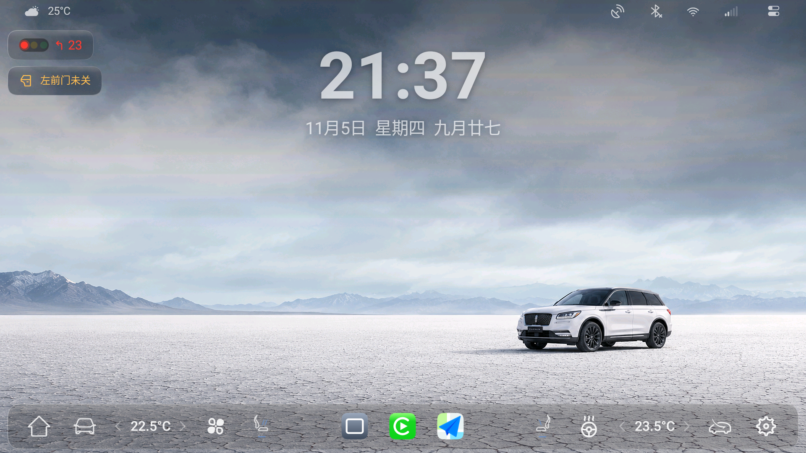
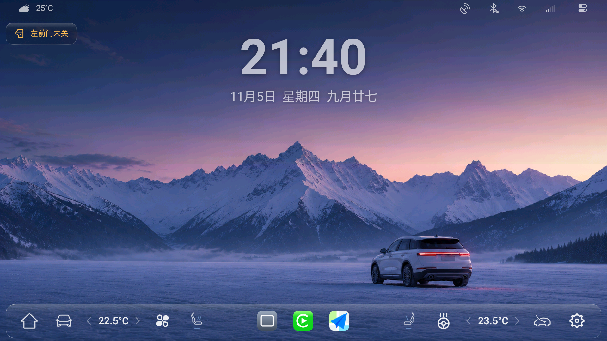
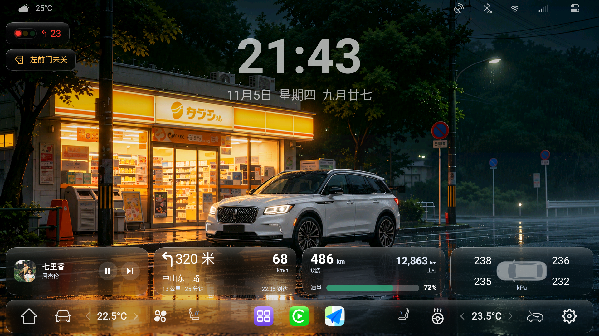
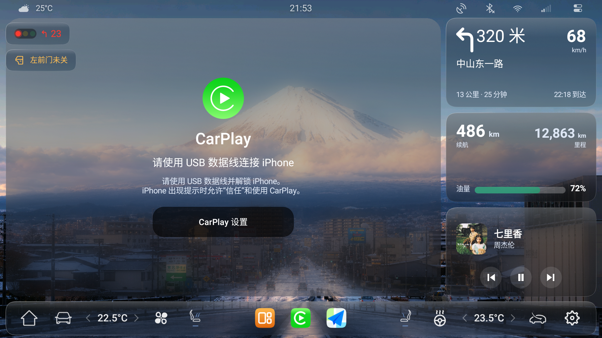
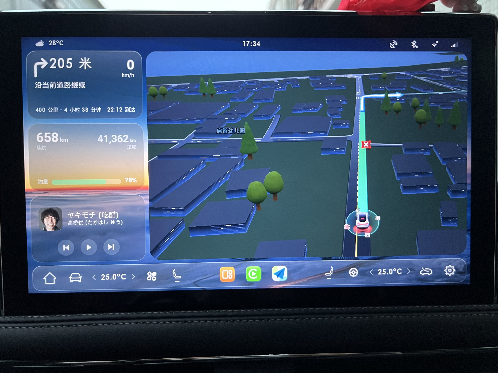
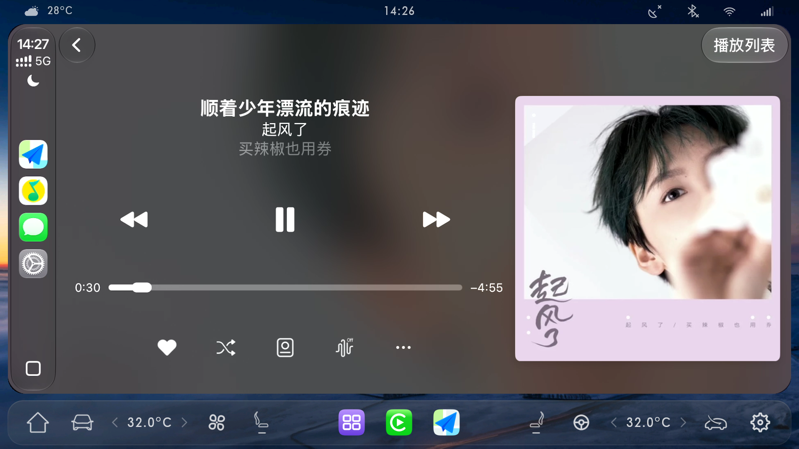
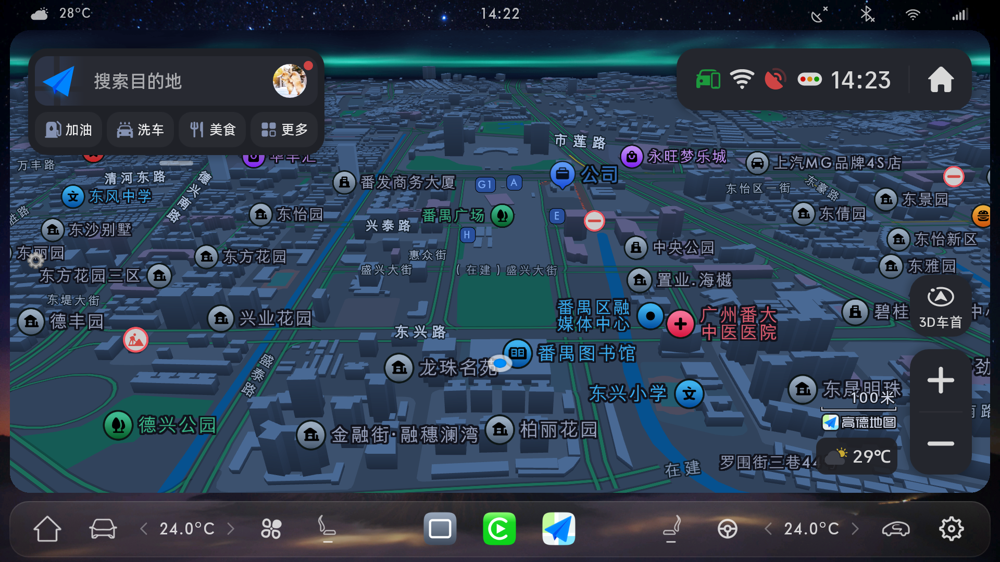

# CorsairPlay

CorsairPlay 是面向林肯/福特车机的 CarPlay 增强版。支持有线/无线连接、导航压低音乐、微信语音修复、方向盘切歌、仪表导航与歌词投屏、桌面卡片等功能。基于 DiPlay 深度优化，主打稳定和流畅。0.3.0 版本支持桌面模式，自带状态栏和导航栏，打通原车数据，可在屏幕上直接显示和控制空调、座椅、方向盘等常用功能，还支持高德地图画中画，红绿灯读秒等功能。

> 本项目仅供个人自用，属于实验性质，不保证稳定性，也不承诺适合所有车型。使用前请自行评估风险。

## 预览

1. CarPlay 模式：纯净画面，可隐藏车机状态栏/导航栏（包含林肯/福特车型的专属适配优化，持续更新，最新版本0.2.28）

2. 桌面模式：自带状态栏和导航栏（定制桌面主题/原车数据打通，非公开版，最新版本0.3.21）

3. 桌面模式：小卡片

4. 桌面模式：CarPlay 副屏 + 小卡片

5. 桌面模式：CarPlay 主屏

6. 桌面模式：高德地图画中画

## 适配情况

- 主要面向林肯/福特车型。
- 已重点适配 Android 8.1 车机。
- 最低支持 Android 7.1。
- 安装包名：`com.corsairplay`
- 公开版本：`0.2.28`
- 付费版本：`0.3.21`

## 主要特性

- 公开版本
  - 支持歌词和导航信息投屏到仪表盘。
  - 支持导航播报时自动压低音乐。
  - 修复微信语音异常，Siri 与小度语音一起使用不冲突。
  - 支持随心听与 CarPlay 音乐切换使用不冲突。
  - 解决小度/Siri被唤醒时媒体音量变大失控的音频冲突。
  - 支持原车“音频关闭”键关闭 CarPlay 媒体声音。
  - 针对有线连接做了多项专门优化。
- 付费版本
  - 桌面模式，打通车辆数据，自定义壁纸，多种布局。
  - CarPlay主屏+副屏同时显示，随意切换。
  - 多种桌面小卡片，音乐/导航卡片支持多种来源实时显示。
  - 车门未关、红绿灯读秒等提示卡片自动出现和退出。
  - 高德地图画中画显示，导航信息仪表/HUD投屏。
  - 与车机随心听4种音源完美融合，蓝牙和CarPlay同时使用不冲突。
  - CarPlay连接专属优化，实现最快5秒连接。
  - 控制面板可以快捷开关Wi-Fi/蓝牙。
  - 支持设置每日壁纸，每日自动从必应获取并更新。

## 安装

1. 下载最新 APK 安装到车机
4. 打开 CorsairPlay，按提示连接 iPhone。
5. 基础 CarPlay 不需要 root；部分车机扩展功能需要申请额外权限。

## 合作说明

联系方式：kriskwok666（备注你的需求）

- 要安装包
  - 99元买断，可获得最新付费版安装包，含桌面模式和车辆数据打通，长期更新维护。
  - 适合：你的车机已破解，可直接安装APP，车型在支持的范围内。
  - ⚠️不提供技术指导，不提供定制，有需求或bug可以提出，合理的反馈会优先处理。

- 要服务
  - 提供全程技术指导、个性化定制等增值服务，单次200～800。
  - 适合：你想获得同款桌面和定制更多个性化功能，我提供全程协助、定制开发等技术服务。

## 风险说明

- 本项目不是 Apple 官方认证产品。
- 安装包包含实验性认证资料，任何拿到 APK 的人都可能提取这些资料。
- 不保证未来 iPhone 系统升级后仍然兼容。
- 不建议在重要行程中完全依赖实验功能，建议先停车测试。

## 开源与许可

本项目基于 xcertplay 开发，主项目使用 GPL-3.0 许可证；部分界面资料来自 DiAuto，使用 AGPL-3.0 许可证。

分发修改后的 APK 时，请保留原许可证、版权说明和对应源代码，不要删除原有署名。中文说明见 LICENSE-NOTICE.zh-CN.md。
